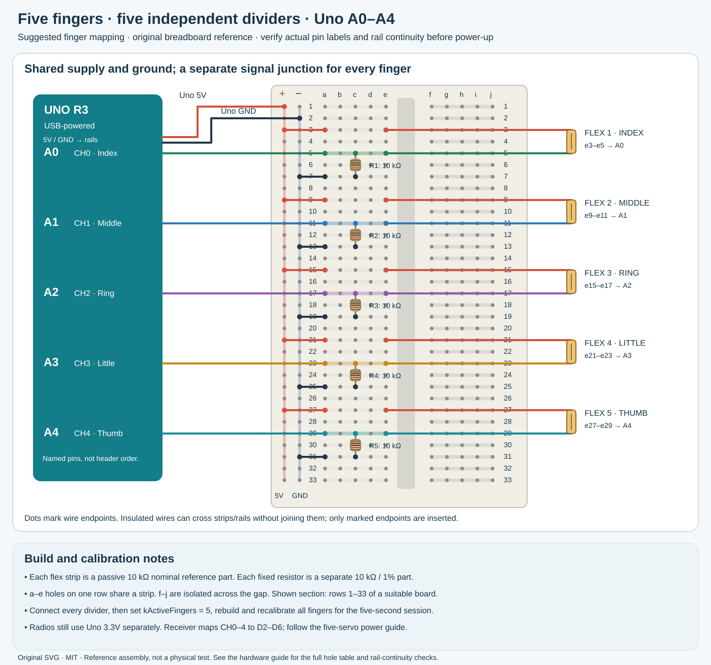

# Flex Sensor Glove

[](https://github.com/kleberandrade/sensor-flex-glove/actions/workflows/ci.yml)


[](LICENSE)

Read resistive flex sensors on an Arduino Uno R3, calibrate and smooth their
readings, and send bounded commands to five independent receiver servos over nRF24L01+ radio.
A standalone serial reader works without a radio or receiver.

The project is a **glove** that reads finger bending with resistive flex sensors.
The original sketches do not identify a Grove sensor module. They do not record
the original board, sensor part number, wiring or mechanical assembly. The documented circuit is an
explicit reference design for discrete resistive sensors, not a reconstruction
of unrecorded hardware. Do not apply it to an unknown Grove module without its
part-specific datasheet.

## The glove at a glance


The drawing shows a **reference placement on the back of the index finger**.
Its 700 → 675 → 160° values come from the synthetic `make example` sequence,
not a physical glove measurement. The last number is a servo command, not a
measured finger angle. Dashed strips indicate optional extra channels; only one
channel and one servo are enabled in the default demonstration.

For a first build, follow the [step-by-step glove guide](docs/BUILD_GUIDE.md):
start with one divider and USB readings, mount the strip, calibrate, then add the
radio and unloaded servo. The guide explains CSV fields, capture, five-channel
expansion and troubleshooting. Review the [electrical BOM and pinout](docs/hardware/README.md)
before wiring.

## Electronics at a glance


This one-channel subset shows the **electronics without the glove**:
the A0 sensor divider, the two Uno/radio nodes, and the receiver's servo with its
own power supply. It is an original reference illustration, not a photograph of
an assembled prototype. Follow the [detailed circuit and electrical pinout](docs/hardware/README.md#circuit-and-pinout)
for actual connections, voltage constraints and component selection.

## Breadboard assembly


Start with the top panel for the radio-free reader: the sensor spans **e5–e10**,
the 10 kΩ resistor spans **c10–c15**, and **a10 connects to A0**. The lower panels
show optional radio wiring on each Uno and the separately powered receiver servo.
Open the image at full size and follow the [hole-by-hole connection table](docs/hardware/README.md#breadboard-assembly)
for the rails, occupied holes, capacitor polarity and pre-power checks. Uno and
radio terminals are named breakouts, not a claim about physical header order.

### Five sensors: one for each finger



Suggested mapping: **index → A0, middle → A1, ring → A2, little → A3,
thumb → A4**. Each sensor needs its **own 10 kΩ fixed resistor**; only 5 V and
GND are shared. The colored A0–A4 junctions must remain separate. This is an
alternative layout: disconnect power and remove the single-sensor jumpers before
moving to its new row positions. Use the [five-sensor hole table](docs/hardware/README.md#five-sensor-breadboard-layout)
and [five-finger build steps](docs/BUILD_GUIDE.md#9-expand-to-multiple-fingers).

After connecting all five dividers, edit `include/flex/hardware.hpp`:

```cpp
constexpr uint8_t kActiveFingers = 5;
```

Rebuild and upload `reader` or `transmitter`, then move **all five fingers** during
the five-second calibration session. CSV channels 0–4 correspond to A0–A4.
The repository default stays at one sensor so the initial quick start works;
five sensors require the configuration change above. The receiver maps channels 0–4 to servos on D2–D6. With the one-sensor
default, only channel 0 is valid and the other four outputs stay detached.

## Five-servo receiver and power


| Finger (suggested) | Sensor / packet channel | Receiver signal |
| --- | --- | --- |
| Index | A0 / 0 | D2 |
| Middle | A1 / 1 | D3 |
| Ring | A2 / 2 | D4 |
| Little | A3 / 3 | D5 |
| Thumb | A4 / 4 | D6 |

The receiver handles all five channels automatically; enable five connected
sensors on the transmitter as shown above. Each validity bit controls its own
servo. A cleared bit detaches that output; malformed packets are discarded
without moving servos or extending their deadlines. After 500 ms without a
valid command, an enabled output detaches and resumes on its next valid command.
A zero mask during calibration detaches every output. Loop/serial scheduling
adds latency; these are software thresholds, not measured physical timings.

Use a **separate regulated servo supply and fused power distributor**, with
individual power/return branches to the servos and one common-ground link to the
receiver. Never run motor current through the Uno or breadboard rails, and do
not connect servo V+ to Uno 5V/VIN. For five reference SG90s, the planning budget
is 5 × 2 A = 10 A, plus 20% headroom: **4.8 V nominal, 12 A**. This is a calculated
starting budget, not measured demand or a universal requirement; verify the
actual servos, startup/stall load, wiring, connectors and protection. See the
[source-backed power guide](docs/hardware/README.md#five-servo-receiver-and-power).

Each `{pin, minUs, maxUs, reversed, speedUsPerSecond}` entry in `hardware::kServos` supplies firmware
defaults; the optional direction and speed fields default to `false` and `0`.
A valid saved receiver EEPROM profile overrides its pulse limits at boot.
Commands 10–170 span **1000–2000 µs by default**, with independent limits for
mechanical calibration. Check every servo unloaded before fitting a horn/linkage.
These endpoints are not a guarantee of safe travel or physical degrees. Detach
stops command pulses; it does not cut power or guarantee torque release.

## Calibrate servo limits over serial

Open the **receiver** monitor at 115200 baud with LF/CR/CRLF endings. Keep the
transmitter off initially and the mechanism unloaded. Send `cal` and wait for
acknowledgement: all outputs detach and RF actuation is paused. Example syntax
(the trial numbers must be checked against your actual servo):

```text
cal
show
set 0 1400 1600
invert 0 1
test 0 1500
stop
save
run
```

`set CH MIN_US MAX_US` edits one channel (0–4); `invert CH 1` reverses it and
`invert CH 0` restores normal direction. `show` includes `reversed` (0/1) and `speed_us_per_s` fields. Direction, limits and speed are saved together. `test CH US` previews only that
servo for a 1000 ms software interval, within its configured limits; its raw
microseconds are not inverted or speed-limited. In RF mode, inversion swaps the min/max command
direction without changing pins, limits, incoming angles or other channels. `save`
explicitly stores the five-channel profile; reset reloads it from EEPROM.
`load` discards RAM edits, `defaults` restores RAM defaults, and `help` lists
commands. Defaults and edits are not persisted until `save`. `run` returns to
fresh radio commands without saving. Valid limits satisfy
`544 ≤ MIN_US < MAX_US ≤ 2400`; this is a software bound, not a safe-travel rating.

The EEPROM format uses two versioned CRC-checked records with fallback to the
last complete valid profile, or firmware defaults. Existing v1 profiles retain
their limits and load in normal direction; v2 also retains inversions. Both load
with speed 0. Explicit save upgrades to a separate v3 bank without overwriting
the legacy slots; identical v3 saves do not write.
See the [complete serial calibration and EEPROM guide](docs/SERVO_CALIBRATION.md)
for gradual endpoint tuning, recovery, reserved addresses and limitations.
This is separate from transmitter ADC calibration with `c`, which stays in RAM.

### Smooth each servo's commands

On the receiver at 115200 baud:

```text
cal
speed 2 500
show
save
run
```

This limits channel 2 / D4 to **500 µs of commanded pulse change per second**;
`speed 2 0` disables the ramp. Rates are 0–10000 µs/s and are saved independently
with the limits/direction. Inversion is applied before the ramp. Timeout/invalid
channels still detach without waiting for movement to finish; the ramp needs
continued valid RF data. Raw `test` previews intentionally bypass it.

A limited channel's first command after boot starts at its configured midpoint;
after detachment it uses its remembered emitted pulse. Neither is a measurement
of physical position or a guarantee of a gentle first movement. Check the
[full speed/ramp and startup guide](docs/SERVO_CALIBRATION.md#smooth-motion-with-an-individual-speed-setting)
before loading a mechanism. The new EEPROM reservation is **0–145**, with v3
slots at 64 and 105 and the old bank kept intact for recovery.

## Applications

- Teach resistive sensing, ADC acquisition, calibration and the noise/latency trade-off.
- Demonstrate up to five independently controlled servos, starting with one unloaded output.
- Record labeled bend data for gesture-recognition experiments.
- Build a host-side bridge for game, music or visual controls.
- Explore comfortable wearable control mappings and accessibility prototypes.

The first two demonstrations use the supplied firmware. Dataset classification,
game/MIDI/HID interfaces, mechanical robotic hands and assistive products require
additional implementation and validation. See [applications and extension paths](docs/APPLICATIONS.md)
for what is available now and what each idea needs.

## Requirements

- Host checks: C++11 compiler and Make; no Arduino hardware or Python needed.
- Firmware: Python 3.12 or 3.13 (CI uses 3.12), PlatformIO Core 6.2.0,
  internet access for the first dependency download, and USB drivers as needed.
- Reference hardware: one Uno for the reader, or two for wireless control;
  see the [BOM, electrical limits and pinout](docs/hardware/README.md).
- Pinned AVR platform 5.3.0, RF24 1.6.2 and Servo 1.3.0. The supported build
  target is Uno R3 / ATmega328P, not Uno R4 or ESP32.

## Install and build

```sh
git clone https://github.com/kleberandrade/sensor-flex-glove.git
cd sensor-flex-glove
python3 -m venv .venv
. .venv/bin/activate
python -m pip install -r requirements-dev.txt
pio run
```

On Windows, activate `.venv\Scripts\activate` and use a Make-capable shell for
host checks. `pio run` builds `transmitter`, `receiver` and `reader` into
`.pio/build/<environment>/firmware.hex`. It does not upload anything.

## Quick start: read one sensor

1. Assemble only the transmitter's A0 divider in the [circuit](docs/hardware/circuit.svg).
2. Upload the radio-free environment to the connected Uno:

   ```sh
   pio run -e reader -t upload
   pio device monitor -b 115200
   ```

3. For the first five seconds after reset, move the sensor through its intended
   range. Opening the serial monitor may reset an Uno and start calibration.
4. Read CSV: `ms,channel,raw,filtered,angle,valid,ack`. Lines starting with `#`
   are status messages. `ack=-1` means radio-free mode.
5. Send lowercase `c` over serial to recalibrate. Bounds stay fixed until then
   or until reset; these **sensor ADC bounds** are not stored in EEPROM. Receiver
   servo pulse limits use the separate serial/EEPROM workflow above.

`valid=0` during calibration or if travel spans fewer than 20 ADC counts.
The angle field remains 10 when invalid and must be ignored. A valid angle is a
servo command, **not a measured physical bend angle**.

## Wireless control

Assemble the two radio nodes and external servo supply from the hardware guide.
Upload each environment to its corresponding board; use `--upload-port` if more
than one is connected:

```sh
pio run -e receiver -t upload --upload-port /dev/cu.usbmodemRECEIVER
pio run -e transmitter -t upload --upload-port /dev/cu.usbmodemTRANSMITTER
```

The port names above are placeholders; list actual ports with `pio device list`.
Use separate serial monitors at 115200 baud. The transmitter reports ACK status
(`1` acknowledged, `0` failed). ACK confirms radio receipt, not servo movement.
The receiver prints accepted `valid_mask,angle0,angle1,angle2,angle3,angle4` CSV
and `# attached/detached channel N` transition messages. Mask bits 0–4 identify
valid channels; ignore angles whose bits are clear. Mask 31 means all five are
valid. Serial comments also report startup and radio initialization errors.

All five receiver outputs start detached. Validity and timeout are evaluated per
channel as described above. The single-sensor quick start can still use just the
D2 servo; leave unused servo power/signals disconnected. Follow the five-servo
power guide before adding the other four actuators.

## Signal processing and configuration

- One connected sensor on A0 is enabled by default. Change `kActiveFingers` in
  [`hardware.hpp`](include/flex/hardware.hpp) to 2–5 only after wiring all those
  consecutive inputs. Receiver channels 0–4 drive D2–D6 independently.
- A sample is scheduled every 20 ms (nominal 50 Hz, without catch-up bursts).
  Radio retries and serial output can add delay. The first ADC conversion is
  discarded after channel selection.
- Each channel uses an eight-sample integer moving average, about 160 ms of
  history and 70 ms steady-state group delay at 50 Hz. Startup averages only
  samples actually taken. A 32-bit sum avoids AVR signed-16-bit overflow.
- The first five seconds collect filtered extrema. A span of at least 20 counts
  is required. Linear mapping clamps to 10–170 and uses 32-bit multiplication.
  Lower ADC values produce lower commands. With the reference divider, bending
  increases resistance and lowers ADC/command. Use receiver serial `cal`, `invert CH 1`, `save`, `run` if a servo needs the
  opposite command direction; transmitter ADC mapping remains unchanged.
- This filter reduces sample noise, but does not remove all spikes, compensate
  sensor hysteresis or linearize physical bending. A disconnected sensor can
  resemble a legitimate reading; there is no reliable disconnect detection.

The portable API in [`core.hpp`](include/flex/core.hpp) supplies `Average`,
`Calibration`, `Packet`, `encode`, `decode` and `expired`. Feed `Average::add`
only validated 10-bit ADC samples. `Calibration::observe/angle` reject samples
outside 0–1023. Invalid calibration leaves the output argument unchanged.
`receiver.hpp` owns validated command state and timeouts; `servo_output.hpp`
maps/clamps commands to configured pulse limits and applies them to a Servo-like
adapter. `hardware.hpp` validates default pulse limits at compile time; serial
and EEPROM inputs are validated before replacing the runtime profile.

## Examples and tests

```sh
make test
make example
pio run
```

The host example uses synthetic ADC readings and prints deterministic
`raw,filtered,angle` CSV. It exercises the same core as the firmware. Host tests
check startup bias, full-scale accumulation, window replacement, calibration
reset/limits and invalid protocol fields. Receiver tests cover five distinct
commands, partial/zero masks, malformed-frame rejection without deadline refresh,
exact timeout/rollover, recovery, pulse bounds and priming before attachment.
A separate host test executes the actual receiver entry points with explicit
RF/Arduino/Servo doubles; these do not simulate AVR timer or physical behavior.
Serial/EEPROM tests additionally cover bounded command parsing, per-servo editing,
manual test expiry, radio suppression, profile reload and interrupted/corrupt
saves. Inversion tests also cover per-channel direction, endpoint preservation,
legacy migration and interrupted direction saves. Speed tests cover fractional progress, target reversal, per-channel persistence,
timeout priority and v1/v2→v3 interrupted migration. CI runs all six host test executables, sanitizers and all three firmware builds. The CI badge reports GitHub's
actual workflow status; no hardware or coverage badge is claimed.

See [validation and work log](docs/WORK_LOG.md) for commands and limitations.
No physical sensor, RF range, oscilloscope or servo integration test has been
performed as part of this modernization.

## Layout and migration

- `firmware/transmitter/`: sensor acquisition, calibration session and telemetry.
- `firmware/receiver/`: radio input and five-servo output with per-channel validity/timeout.
- `include/flex/`: portable processing/protocol and shared hardware settings.
- `tests/`, `examples/`: executable host behavior checks and reading example.
- `docs/hardware/`: original SVG reference circuit, BOM and primary sources.
- `docs/images/`: original illustrations; guides live directly under `docs/`.

See the [folder conventions and contribution guide](docs/CONTRIBUTING.md) for
the complete tree, shared-reader design and validation workflow.

The old `RF_send/RF_send.ino` and `RF_receive/RF_receive.ino` entry points moved
to the firmware directories. Use PlatformIO environments instead of opening the
old sketches. The old firmware remains available in Git at `7e0747e`.

When migrating from the original native-`int` protocol, flash both nodes together.
The five-servo receiver upgrade preserves protocol v1, so an existing v1
transmitter stays compatible. Its one-channel default leaves D3–D6 detached;
enable five wired sensors for five-channel motion. Receiver pulse mapping now
uses explicit 1000–2000 µs endpoints instead of the old default 544–2400 µs angle
mapping: recheck every actuator's travel before using a mechanism. Receiver CSV
also changes from one angle to a validity mask plus five angles.

Protocol v1 uses exactly 10 bytes:
`0xF1`, version `1`, little-endian unsigned 16-bit sequence, a five-bit valid
channel mask, then five unsigned 8-bit angles. Inactive channels carry 10 with
their mask bit clear. Decoding checks length, magic, version, reserved mask bits
and all five angles. Sequence wraps naturally and is diagnostic only; there is
no replay protection, encryption or transmitter authentication. RF hardware
CRC16 and automatic acknowledgments are enabled.

Both nodes use address `flex1`, channel 76 (2476 MHz), 250 kbps, low PA and a
fixed payload. These replace the old native-`int` struct, address and channel
115 (2515 MHz). The plus radio variant is required for 250 kbps. Consult local
radio rules for your deployment; channel choice alone does not establish
regulatory compliance. The original 2017 firmware and protocol v1 are incompatible.

The current receiver writes EEPROM schema v3 independently of the RF format;
it reads v1/v2 profiles with speed 0 (and preserves v2 directions). An empty/invalid receiver EEPROM uses firmware defaults without writing;
a saved profile takes precedence over source-code defaults. See the calibration
guide before migrating existing actuator travel settings.

## License

Original project code and documentation are [MIT licensed](LICENSE).
[Third-party licenses](docs/THIRD_PARTY.md), including RF24's GPL-2.0, still
apply to their respective dependencies and linked firmware distributions.
