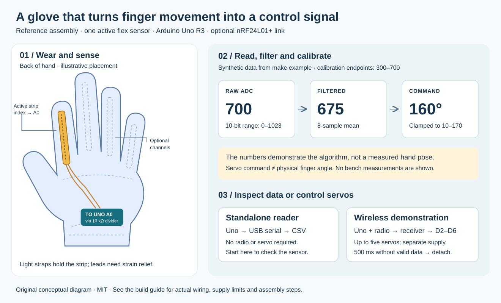
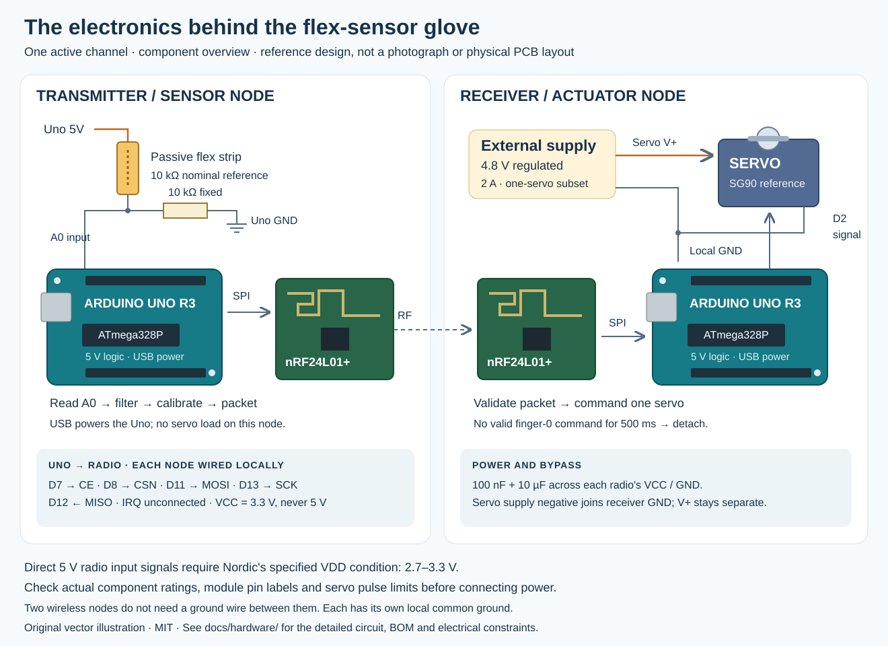
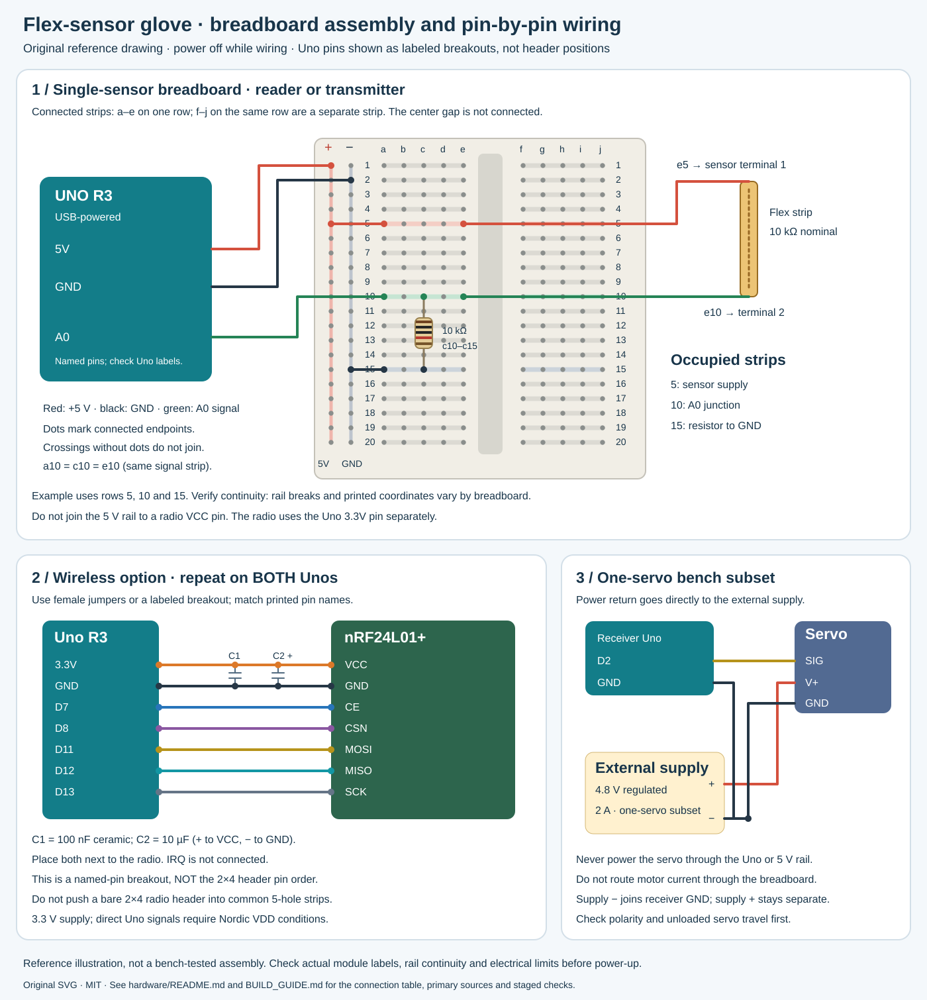

# Flex Sensor Glove

[](https://github.com/kleberandrade/sensor-flex-glove/actions/workflows/ci.yml)


[](LICENSE)

Read resistive flex sensors on an Arduino Uno R3, calibrate and smooth their
readings, and send bounded servo commands to another Uno over nRF24L01+ radio.
A standalone serial reader works without a radio or receiver.

The project is a **glove** that reads finger bending with resistive flex sensors.
The original sketches do not identify a Grove sensor module. They do not record
the original board, sensor part number, wiring or mechanical assembly. The documented circuit is an
explicit reference design for discrete resistive sensors, not a reconstruction
of unrecorded hardware. Do not apply it to an unknown Grove module without its
part-specific datasheet.

## The glove at a glance



The drawing shows a **reference placement on the back of the index finger**.
Its 700 → 675 → 160° values come from the synthetic `make example` sequence,
not a physical glove measurement. The last number is a servo command, not a
measured finger angle. Dashed strips indicate optional extra channels; only one
channel and one servo are enabled in the default demonstration.

For a first build, follow the [step-by-step glove guide](docs/BUILD_GUIDE.md):
start with one divider and USB readings, mount the strip, calibrate, then add the
radio and unloaded servo. The guide explains CSV fields, capture, five-channel
expansion and troubleshooting. Review the [electrical BOM and pinout](docs/hardware/README.md)
before wiring.

## Electronics at a glance



This separate component illustration shows the **electronics without the glove**:
the A0 sensor divider, the two Uno/radio nodes, and the receiver's servo with its
own power supply. It is an original reference illustration, not a photograph of
an assembled prototype. Follow the [detailed circuit and electrical pinout](docs/hardware/README.md#circuit-and-pinout)
for actual connections, voltage constraints and component selection.

## Breadboard assembly



Start with the top panel for the radio-free reader: the sensor spans **e5–e10**,
the 10 kΩ resistor spans **c10–c15**, and **a10 connects to A0**. The lower panels
show optional radio wiring on each Uno and the separately powered receiver servo.
Open the image at full size and follow the [hole-by-hole connection table](docs/hardware/README.md#breadboard-assembly)
for the rails, occupied holes, capacitor polarity and pre-power checks. Uno and
radio terminals are named breakouts, not a claim about physical header order.

### Five sensors: one for each finger


Suggested mapping: **index → A0, middle → A1, ring → A2, little → A3,
thumb → A4**. Each sensor needs its **own 10 kΩ fixed resistor**; only 5 V and
GND are shared. The colored A0–A4 junctions must remain separate. This is an
alternative layout: disconnect power and remove the single-sensor jumpers before
moving to its new row positions. Use the [five-sensor hole table](docs/hardware/README.md#five-sensor-breadboard-layout)
and [five-finger build steps](docs/BUILD_GUIDE.md#9-expand-to-multiple-fingers).

After connecting all five dividers, edit `include/flex/hardware.hpp`:

```cpp
constexpr uint8_t kActiveFingers = 5;
```

Rebuild and upload `reader` or `transmitter`, then move **all five fingers** during
the five-second calibration session. CSV channels 0–4 correspond to A0–A4.
The repository default stays at one sensor so the initial quick start works;
five sensors require the configuration change above. The supplied receiver
still actuates only channel 0: five-channel sensing does not add five servos.

## Applications

- Teach resistive sensing, ADC acquisition, calibration and the noise/latency trade-off.
- Demonstrate one-finger wireless control of an unloaded servo.
- Record labeled bend data for gesture-recognition experiments.
- Build a host-side bridge for game, music or visual controls.
- Explore comfortable wearable control mappings and accessibility prototypes.

The first two demonstrations use the supplied firmware. Dataset classification,
game/MIDI/HID interfaces, multi-servo hands and assistive products require
additional implementation and validation. See [applications and extension paths](docs/APPLICATIONS.md)
for what is available now and what each idea needs.

## Requirements

- Host checks: C++11 compiler and Make; no Arduino hardware or Python needed.
- Firmware: Python 3.12 or 3.13 (CI uses 3.12), PlatformIO Core 6.2.0,
  internet access for the first dependency download, and USB drivers as needed.
- Reference hardware: one Uno for the reader, or two for wireless control;
  see the [BOM, electrical limits and pinout](docs/hardware/README.md).
- Pinned AVR platform 5.3.0, RF24 1.6.2 and Servo 1.3.0. The supported build
  target is Uno R3 / ATmega328P, not Uno R4 or ESP32.

## Install and build

```sh
git clone https://github.com/kleberandrade/sensor-flex-glove.git
cd sensor-flex-glove
python3 -m venv .venv
. .venv/bin/activate
python -m pip install -r requirements-dev.txt
pio run
```

On Windows, activate `.venv\Scripts\activate` and use a Make-capable shell for
host checks. `pio run` builds `transmitter`, `receiver` and `reader` into
`.pio/build/<environment>/firmware.hex`. It does not upload anything.

## Quick start: read one sensor

1. Assemble only the transmitter's A0 divider in the [circuit](docs/hardware/circuit.svg).
2. Upload the radio-free environment to the connected Uno:

   ```sh
   pio run -e reader -t upload
   pio device monitor -b 115200
   ```

3. For the first five seconds after reset, move the sensor through its intended
   range. Opening the serial monitor may reset an Uno and start calibration.
4. Read CSV: `ms,channel,raw,filtered,angle,valid,ack`. Lines starting with `#`
   are status messages. `ack=-1` means radio-free mode.
5. Send lowercase `c` over serial to recalibrate. Bounds stay fixed until then
   or until reset; they are not stored in EEPROM.

`valid=0` during calibration or if travel spans fewer than 20 ADC counts.
The angle field remains 10 when invalid and must be ignored. A valid angle is a
servo command, **not a measured physical bend angle**.

## Wireless control

Assemble the two radio nodes and external servo supply from the hardware guide.
Upload each environment to its corresponding board; use `--upload-port` if more
than one is connected:

```sh
pio run -e receiver -t upload --upload-port /dev/cu.usbmodemRECEIVER
pio run -e transmitter -t upload --upload-port /dev/cu.usbmodemTRANSMITTER
```

The port names above are placeholders; list actual ports with `pio device list`.
Use separate serial monitors at 115200 baud. The transmitter reports ACK status
(`1` acknowledged, `0` failed). ACK confirms radio receipt, not servo movement.
The receiver prints accepted finger-0 angles and timeout messages.

The receiver starts detached. It stops sending servo pulses on an explicitly
invalid finger-0 calibration packet or after 500 ms without a valid finger-0
command, and resumes on the next valid command. Detach releases the servo's
command signal; it does not cut power or guarantee a safe mechanical position.
Check travel with the horn/linkage disconnected before loading a mechanism.

## Signal processing and configuration

- One connected sensor on A0 is enabled by default. Change `kActiveFingers` in
  [`hardware.hpp`](include/flex/hardware.hpp) to 2–5 only after wiring all those
  consecutive inputs. The receiver currently controls one servo on D2.
- A sample is scheduled every 20 ms (nominal 50 Hz, without catch-up bursts).
  Radio retries and serial output can add delay. The first ADC conversion is
  discarded after channel selection.
- Each channel uses an eight-sample integer moving average, about 160 ms of
  history and 70 ms steady-state group delay at 50 Hz. Startup averages only
  samples actually taken. A 32-bit sum avoids AVR signed-16-bit overflow.
- The first five seconds collect filtered extrema. A span of at least 20 counts
  is required. Linear mapping clamps to 10–170 and uses 32-bit multiplication.
  Lower ADC values produce lower commands. With the reference divider, bending
  increases resistance and lowers ADC/command. Reverse the mapping in your
  application if its mechanical motion requires the opposite direction.
- This filter reduces sample noise, but does not remove all spikes, compensate
  sensor hysteresis or linearize physical bending. A disconnected sensor can
  resemble a legitimate reading; there is no reliable disconnect detection.

The portable API in [`core.hpp`](include/flex/core.hpp) supplies `Average`,
`Calibration`, `Packet`, `encode`, `decode` and `expired`. Feed `Average::add`
only validated 10-bit ADC samples. `Calibration::observe/angle` reject samples
outside 0–1023. Invalid calibration leaves the output argument unchanged.

## Examples and tests

```sh
make test
make example
pio run
```

The host example uses synthetic ADC readings and prints deterministic
`raw,filtered,angle` CSV. It exercises the same core as the firmware. Host tests
check startup bias, full-scale accumulation, window replacement, calibration
reset and limits, invalid protocol fields and timeout rollover. CI runs these
checks, sanitizers and all three firmware builds. The CI badge reports GitHub's
actual workflow status; no hardware or coverage badge is claimed.

See [validation and work log](docs/WORK_LOG.md) for commands and limitations.
No physical sensor, RF range, oscilloscope or servo integration test has been
performed as part of this modernization.

## Layout and migration

- `firmware/transmitter/`: sensor acquisition, calibration session and telemetry.
- `firmware/receiver/`: radio input and one-servo output with loss timeout.
- `include/flex/`: portable processing/protocol and shared hardware settings.
- `tests/`, `examples/`: executable host behavior checks and reading example.
- `docs/hardware/`: original SVG reference circuit, BOM and primary sources.
- `docs/images/`: original illustrations; guides live directly under `docs/`.

See the [folder conventions and contribution guide](docs/CONTRIBUTING.md) for
the complete tree, shared-reader design and validation workflow.

The old `RF_send/RF_send.ino` and `RF_receive/RF_receive.ino` entry points moved
to the firmware directories. Use PlatformIO environments instead of opening the
old sketches. The old firmware remains available in Git at `7e0747e`.

**Flash both wireless nodes together.** Protocol v1 uses exactly 10 bytes:
`0xF1`, version `1`, little-endian unsigned 16-bit sequence, a five-bit valid
channel mask, then five unsigned 8-bit angles. Inactive channels carry 10 with
their mask bit clear. Decoding checks length, magic, version, reserved mask bits
and all five angles. Sequence wraps naturally and is diagnostic only; there is
no replay protection, encryption or transmitter authentication. RF hardware
CRC16 and automatic acknowledgments are enabled.

Both nodes use address `flex1`, channel 76 (2476 MHz), 250 kbps, low PA and a
fixed payload. These replace the old native-`int` struct, address and channel
115 (2515 MHz). The plus radio variant is required for 250 kbps. Consult local
radio rules for your deployment; channel choice alone does not establish
regulatory compliance. Old and new firmware are incompatible.

## License

Original project code and documentation are [MIT licensed](LICENSE).
[Third-party licenses](docs/THIRD_PARTY.md), including RF24's GPL-2.0, still
apply to their respective dependencies and linked firmware distributions.
