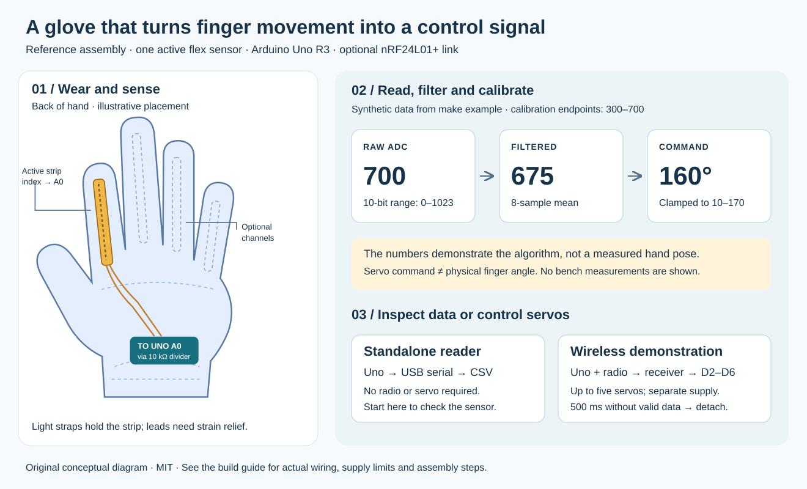
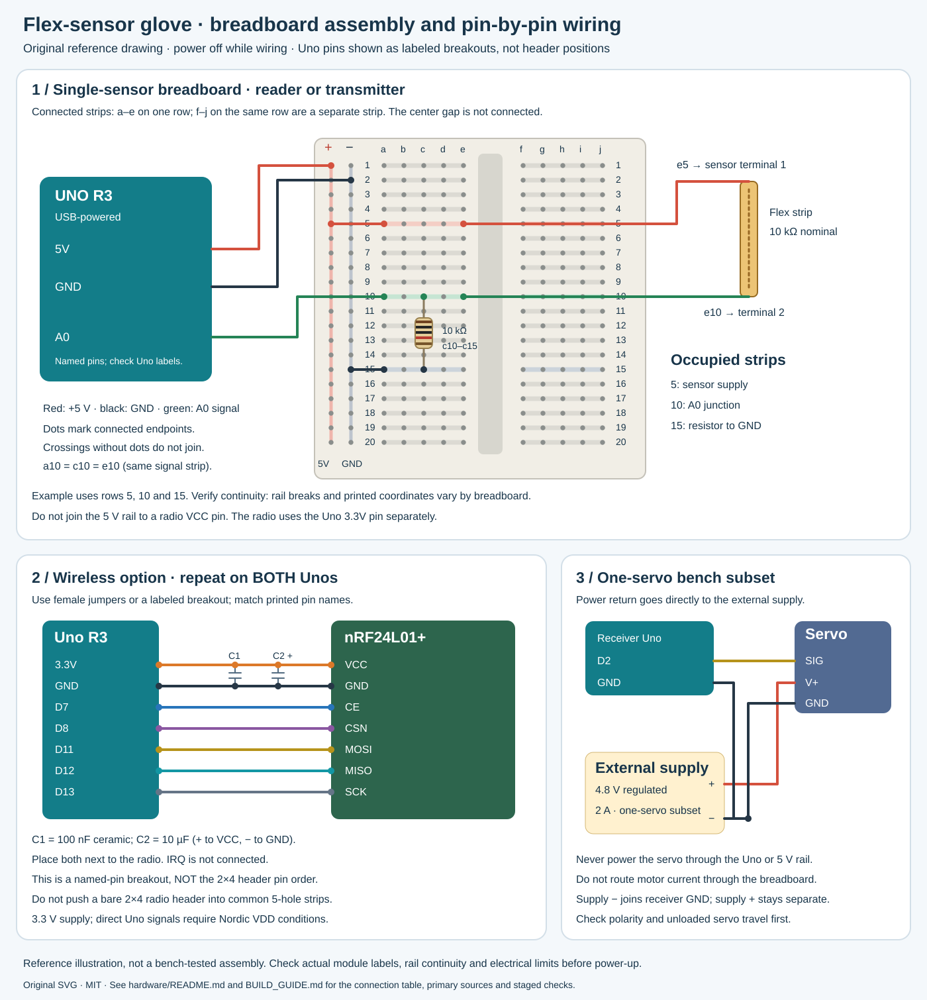
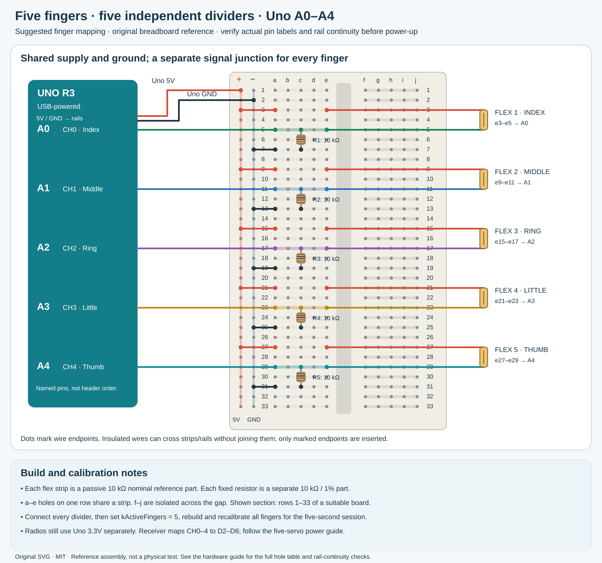

# Build a flex-sensor glove, step by step

This guide builds the reference design in stages: first a single sensor and USB
serial output, then a wearable mounting, then wireless control of up to five
servos, starting with one unloaded output. Each stage has a check before adding more parts. All assembly procedures
below still need validation on your actual hardware; the repository's automated
checks exercise software and compilation.



## 1. Choose your first milestone

Start with **one finger, one flex sensor, one Uno and the `reader` environment**.
That is already a useful bend-to-command demonstration. Add the second Uno and
the radios only after stable readings are visible. Five sensor channels are
supported by the transmitter and receiver; the default one-sensor transmitter
keeps the other receiver outputs detached.

Have a computer with USB, a breadboard, a multimeter, short jumpers, a glove,
soft fabric loops or removable tape, and the [reference BOM](hardware/README.md#bill-of-materials).
Choose a glove that allows free movement and can carry lightweight sensor leads.
Keep the Uno and breadboard on the bench initially; the illustration's wrist
block is a lead-routing point, not a compact custom PCB supplied by this project.

Read the exact part markings before connecting power. This guide uses a passive
resistive strip, not an unspecified Grove module. If your module includes an
amplifier, a four-pin connector or a digital interface, identify it and adapt
the circuit from its own primary documentation first.

## 2. Prepare the software

Use Python 3.12 or 3.13 and a C++11 compiler with Make. From the repository root:

```sh
python3 -m venv .venv
. .venv/bin/activate
python -m pip install -r requirements-dev.txt
make test example
pio run
pio device list
```

On Windows activate `.venv\Scripts\activate`; use a Make-capable shell for the
host example. The expected host result includes `Core behavior checks passed`
and a CSV beginning with `raw,filtered,angle`. The firmware build should report
success for `transmitter`, `receiver` and `reader`. No board is needed to compile.

The example's readings are deliberately artificial. They validate calculations,
not the electrical characteristics or accuracy of a physical sensor.

## 3. Wire and check a single divider



Use the [hole-by-hole breadboard table](hardware/README.md#breadboard-assembly):
flex e5–e10, fixed resistor c10–c15, Uno A0 to a10, and the supply/ground jumpers
shown in the top panel. Verify your board's strip and rail continuity before
following the example row numbers. Lower panels are optional wireless additions.

Keep power disconnected while assembling. Follow the
[pinout and circuit](hardware/README.md#circuit-and-pinout):

1. Connect one terminal of the reference flex sensor to Uno 5V.
2. Connect its other terminal to A0 and to one end of a 10 kΩ fixed resistor.
3. Connect the resistor's other end to Uno GND.
4. Check for unintended shorts and ensure neither sensor terminal touches a
   neighboring connection. Use strain relief near the sensor's terminals.
5. Power the Uno by USB. Use the multimeter to confirm the supply and divider
   output are within the Uno ADC's 0–supply-voltage input range.

There is no extra 5 V connection to A0: it receives only the divider junction.
Leave A1–A4 inactive in configuration until their own dividers are connected.
The reference calculations are about 512 counts for a flat nominal 10 kΩ sensor
and 341 counts for 20 kΩ. Tolerances and mounting will change actual readings.

## 4. Upload the standalone reader

Substitute a real port from `pio device list`:

```sh
pio run -e reader -t upload --upload-port /dev/cu.usbmodemREADER
pio device monitor -p /dev/cu.usbmodemREADER -b 115200
```

On Linux ports often resemble `/dev/ttyACM0`; on Windows use `COM3` or the port
reported for your device. These names are examples. Close other serial programs
before opening the port or uploading. On Linux ensure your user can access the
serial device according to your distribution's permissions.

Opening the monitor can reset the Uno. Immediately move the sensor slowly
through its full intended range for five seconds, then hold still. Send lowercase
`c` to repeat calibration. Do not crease the strip or bend its terminals.

During calibration `valid` is 0. It becomes 1 only after the five-second session
has ended and the observed filtered range spans at least 20 ADC counts. If it
stays 0, check the raw readings, wiring, sensor motion and fixed resistor choice
before changing the threshold. Calibration is per channel and is lost on reset.

## 5. Understand and capture the readings

The firmware emits `ms,channel,raw,filtered,angle,valid,ack`. Status/header lines
start with `#`. For example, this **constructed reader-mode row** uses the same
last three values as the executable host example:

```csv
6000,0,700,675,160,1,-1
```

It means 6,000 ms after boot, channel 0/A0, raw ADC 700, filtered ADC 675,
command 160, calibration valid, and no radio in use. It is not a captured physical
measurement. The host example deliberately calibrates to 300–700; your glove's
endpoints will depend on the actual assembly.

- `raw` is the unscaled 10-bit ADC sample; no voltage or resistance measurement
  is transmitted directly.
- `filtered` is the integer mean of up to eight actual samples; a steady value
  should settle after the window fills. It adds roughly 70 ms of group delay at
  a nominal 50 Hz sample rate.
- `angle` is a bounded servo command. It is meaningful only if `valid=1` and
  does not represent an absolute finger-joint angle.
- `ack` is `-1` in reader mode, `0` for failed radio acknowledgement and `1` for
  a successful radio acknowledgement. An ACK is not confirmation of motion.

To save a session in a POSIX shell, first create an output directory outside the
tracked source, then use the monitor's raw/quiet mode:

```sh
mkdir -p build
pio device monitor -p /dev/cu.usbmodemREADER -b 115200 --raw --quiet | tee build/session.log
```

Use Ctrl+C to stop. Remove `#` lines before importing the seven numeric columns
into a spreadsheet or your own analysis program. Retain the calibration context,
sensor part, finger placement, session date and sampling settings alongside the
file. A serial capture/plotting application is optional; none is bundled here.

## 6. Mount the sensor on the glove

The drawing uses the index finger as channel 0 for illustration. The firmware
knows only channel numbers; you can choose another finger without changing its
single-channel behavior.

1. With electronics unpowered and the glove off the hand, place the strip along
   the back of the chosen finger following the manufacturer's permitted bend
   direction. Keep its terminal region away from the knuckle's sharp bend.
2. Use loose fabric loops or removable tape to guide the strip while allowing it
   to slide slightly as the finger bends. Do not immobilize the entire strip or
   glue directly over an active bend unless the manufacturer permits it.
3. Anchor the wires separately at the back of the hand/wrist so pulling a lead
   does not pull the sensor contacts. Avoid sharp edges and exposed conductors.
4. Wear the glove with power disconnected and check comfortable motion. Remove
   it to adjust mounting; then reconnect the bench reader and recalibrate.
5. Compare repeated open/closed poses. Record variation and drift rather than
   assuming a universal angle or resistance relationship.

Relocating the strip changes the measured range. Recalibrate whenever the glove,
mounting, sensor, divider resistor or intended travel changes. This firmware
calibrates electrical extrema, not a person's biomechanics.

## 7. Add the radio link

Use two standard, non-amplified nRF24L01+ modules. Wire each node to its own Uno
as documented in the [hardware guide](hardware/README.md); the 250 kbps setting
requires the plus variant. Add 100 nF and 10 µF capacitors locally across each
radio's supply and ground. Verify radio supply/logic conditions from that guide.
Do not connect the radio's VCC to Uno 5V.

Initially leave the servo and its external supply disconnected. Upload the
`receiver` environment to the receiver Uno and `transmitter` to the sensor Uno.
Both must use the same protocol, address, channel and data rate:

```sh
pio run -e receiver -t upload --upload-port /dev/cu.usbmodemRECEIVER
pio run -e transmitter -t upload --upload-port /dev/cu.usbmodemTRANSMITTER
```

Open separate monitors for the two real ports. Calibrate the transmitter. The
transmitter should report successful ACKs and the receiver should print
`valid_mask,angle0,angle1,angle2,angle3,angle4` CSV. A one-sensor calibration
normally produces mask 1; five valid channels produce mask 31. Attach/detach
changes appear as comment lines. A `# ERROR` line indicates radio initialization failed; the
firmware then stops normal operation until reset. An unsupported 250 kbps mode
is also treated as an initialization error.

## 8. Add one unloaded servo

1. Disconnect power and leave the horn/linkage mechanically unloaded.
2. Connect receiver D2 to servo signal, and connect servo ground to both the
   external supply negative and receiver ground.
3. Connect servo V+ only to its correctly rated external supply. For the reference
   SG90 this guide budgets a regulated 4.8 V supply capable of 2 A. Check the
   actual unit's requirements. Do not use the Uno's rail for servo power.
4. Check polarity, supply voltage and pulse/travel limits before powering.
5. Run the pair and observe the response without a person or mechanism in its
   travel path. Default commands span 10–170; use the receiver's
   [serial calibration mode](SERVO_CALIBRATION.md) to tune/save its pulse limits
   before coupling a mechanism. Source-code `kServos` entries are boot defaults.
6. Remove transmitter power and verify receiver timeout handling. The firmware
   detaches each enabled output after 500 ms without its valid command.
   Recalibrating also sends invalid commands and detaches the servo while the session runs.

Detaching stops pulse generation but neither disconnects servo power nor proves
that a mechanical load is safe. Validate the complete setup before adding load.
Do not infer radio range, reaction time or mechanical accuracy from host tests.

## 9. Expand to multiple fingers



This optional layout uses five sensor/resistor pairs. Suggested assignment:
**index=A0, middle=A1, ring=A2, little=A3, thumb=A4**. Document the assignment if
your glove uses a different one. Follow the [complete hole table](hardware/README.md#five-sensor-breadboard-layout)
for the shared rails, each flex sensor, fixed resistor and ADC jumper.

1. Disconnect USB and every external supply. This five-channel image uses new
   row positions, so remove/reposition the earlier single-sensor jumpers first.
2. Assemble five independent dividers. Use rows 5, 11, 17, 23 and 29 as the ADC
   junctions for A0, A1, A2, A3 and A4 respectively. Every branch has its own
   fixed resistor; no two ADC junctions are joined directly.
3. Verify rail continuity over the used rows and check each divider against the
   table. Check for direct shorts from signal junctions to either rail before
   reconnecting power. The radio still uses 3.3V, never the divider's 5 V rail.
4. Set the existing declaration in `include/flex/hardware.hpp` to:

   ```cpp
   constexpr uint8_t kActiveFingers = 5;
   ```

5. Rebuild and upload the reader first; substitute your actual port:

   ```sh
   pio run -e reader
   pio run -e reader -t upload --upload-port /dev/cu.usbmodemREADER
   pio device monitor -p /dev/cu.usbmodemREADER -b 115200
   ```

6. During the five-second startup session, move **all five fingers** through their
   intended comfortable range. Send `c` and repeat if any channel's filtered
   travel was less than 20 counts. Calibration is independent for each channel.
7. Verify CSV rows for channels **0, 1, 2, 3 and 4** (A0–A4). Move one finger at
   a time and check that its assigned channel changes and reports `valid=1` after
   calibration. Record drift/coupling rather than assuming mechanically isolated
   movement. These observations require the actual assembled glove.
8. For wireless operation, build/upload `transmitter` with the same five-channel
   configuration after reader checks pass. Its packet will carry five command
   slots and a per-channel validity mask. The receiver code remains unchanged.

The repository defaults to one sensor for the single-channel quick start. Values
from 1 to 5 enable that many **consecutive** inputs; for example, 3 enables A0–A2,
not A0 and A4 alone. Return `kActiveFingers` to 1 when only A0 is connected.
Do not enable inputs that are floating.

### Connect all five receiver servos

The receiver now handles all five packet channels automatically. Follow the
[five-servo power and signal diagram](hardware/README.md#five-servo-receiver-and-power):
index/channel 0 → D2, middle/1 → D3, ring/2 → D4, little/3 → D5, thumb/4 → D6.
The mapping is a suggested anatomical assignment; packet indices and pins are
fixed by the configuration, not by how the glove is worn.

1. Disconnect power. Replace the one-servo power arrangement with an appropriately
   sized external supply and fused distributor/harness before adding motors.
   The reference five-SG90 planning budget is regulated 4.8 V nominal / 12 A;
   verify actual demand and wire/connector ratings as explained in the power guide.
2. Route each servo's V+ and GND directly to that distributor. Connect receiver
   GND separately to supply negative. Do not connect motor V+ to Uno 5V/VIN or
   route servo current through breadboard rails. Keep radio VCC on Uno 3.3V.
3. With horns/linkages unloaded, connect one servo signal at a time to D2–D6.
   Enter `cal` on the receiver serial monitor and follow the
   [individual calibration guide](SERVO_CALIBRATION.md): `set CH MIN_US MAX_US`,
   `test CH US`, then explicit `save`. Start with a narrow verified range and
   test one servo at a time before fitting a mechanism. Defaults are 1000–2000 µs;
   command 10 maps to min, 170 to max, and 90 to the midpoint. These are commands,
   not physical joint-angle measurements.
4. Use `show` to verify all five settings and `run` to resume fresh RF commands.
   No rebuild is needed for serial endpoint changes; EEPROM reloads them after
   reset. The receiver is already five-channel capable and does not use
   `kActiveFingers` to limit its outputs. That constant controls transmitter
   sensor acquisition only.
5. Calibrate all five sensors. Verify each finger's channel, servo mapping and
   travel independently, then simultaneous motion and supply voltage under load.
6. Confirm that a missing calibration bit detaches only that channel, calibration
   mask 0 detaches all, and transmitter power loss detaches all enabled outputs
   once their 500 ms software threshold is reached. Resume with valid data and
   verify recovery without an unintended initial pulse target.

Malformed packets are ignored and cannot refresh deadlines. Clear validity bits
and timeout both stop pulses for their channels; they do not switch motor power
or guarantee torque release. RF ACKs still confirm receipt, not servo motion.
Host tests and CI cover logic/build behavior, while every mechanical, waveform
and supply check in this section needs actual bench validation.

## Receiver serial calibration checkpoint

Connect to the receiver at 115200 baud; keep transmitter motion disabled until
`cal` is acknowledged. `cal` and `stop` detach all outputs and pause RF actuation.
A `test` command drives just the selected servo for up to a 1000 ms loop-checked
interval; `save` detaches before writing EEPROM. `run` clears stale radio data
and resumes only on fresh packets. Test every channel and verify saved values
with `show` after a reset. Follow [SERVO_CALIBRATION.md](SERVO_CALIBRATION.md) for
all commands, input limits, EEPROM recovery and a gradual unloaded workflow.
Transmitter `c` still calibrates sensor ADC bounds in RAM; it does not set or save
receiver pulse endpoints.

## 10. Troubleshoot by stage

| Symptom | Check | Next action |
| --- | --- | --- |
| No serial port | USB data cable, drivers, device list | Resolve USB before investigating sensors |
| Upload fails | Correct environment/port, monitor closed | Retry with the correct Uno selected |
| Raw value stays near a rail | Divider junction, open/short wiring, correct part | Measure voltage; software cannot reliably detect an unplugged sensor |
| No change when bending | Sensor direction, placement, resistor value | Return to a single loose sensor on the bench |
| `valid=0` after calibration | Filtered travel below 20 counts, incomplete motion | Correct wiring/mounting and send `c` |
| Excessive noise | Ground, jumper length, supply stability, moving contacts | Fix the electrical cause before increasing filtering |
| ACKs fail | Matching firmware settings, radio supply, SPI pin labels, plus variant | Test radios without the servo load |
| Servo jitters or radio resets | External supply capacity and ground routing | Remove load, inspect rails and return path |
| Motion is opposite to desired | Reference divider lowers ADC as bend increases | Adapt the command mapping and its tests for your mechanism |
| Motion hits a stop | Servo-specific pulse limits and linkage travel | Disconnect the linkage; tune receiver endpoints in `cal` mode |
| Serial edits are rejected | Wrong board/baud/line ending or RF mode active | Use the receiver at 115200, newline, then `cal` |
| Limits revert after reset | RAM-only edit, save failure or invalid EEPROM | Check `show`, wait for `save` success, inspect load/fallback status |
| Servo ignores the glove | Calibration mode still active | Finish/stop manual tests, then send `run` |
| Manual servo test stops | The 1000 ms preview interval elapsed | Expected behavior; repeat a deliberate test or send `run` |

## Next steps

See [applications and extension paths](APPLICATIONS.md), the
[project layout and contribution guide](CONTRIBUTING.md), and the
[protocol/migration reference](../README.md#layout-and-migration).
