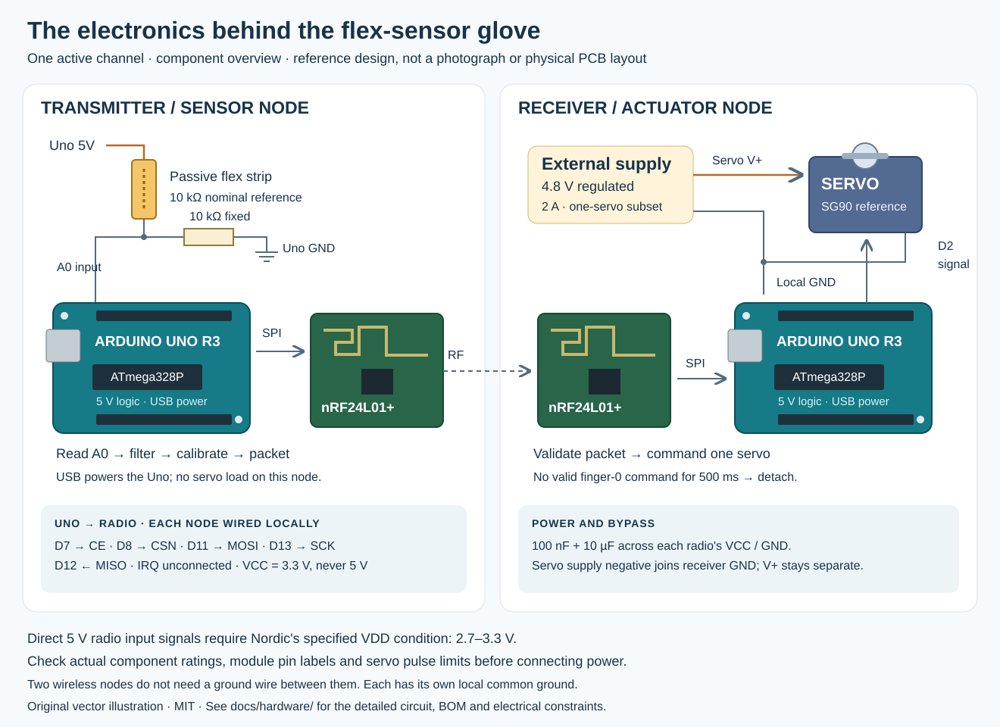
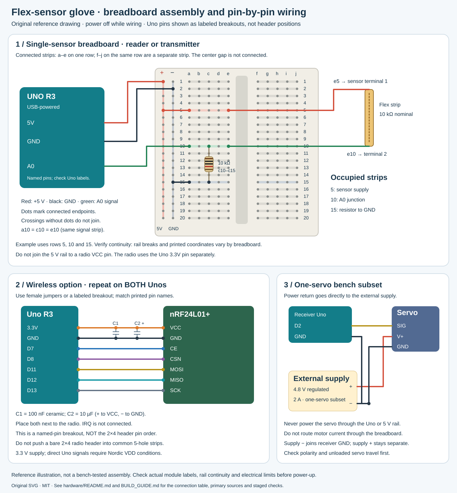
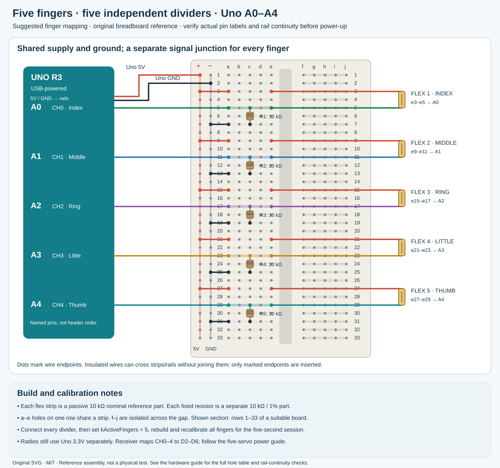
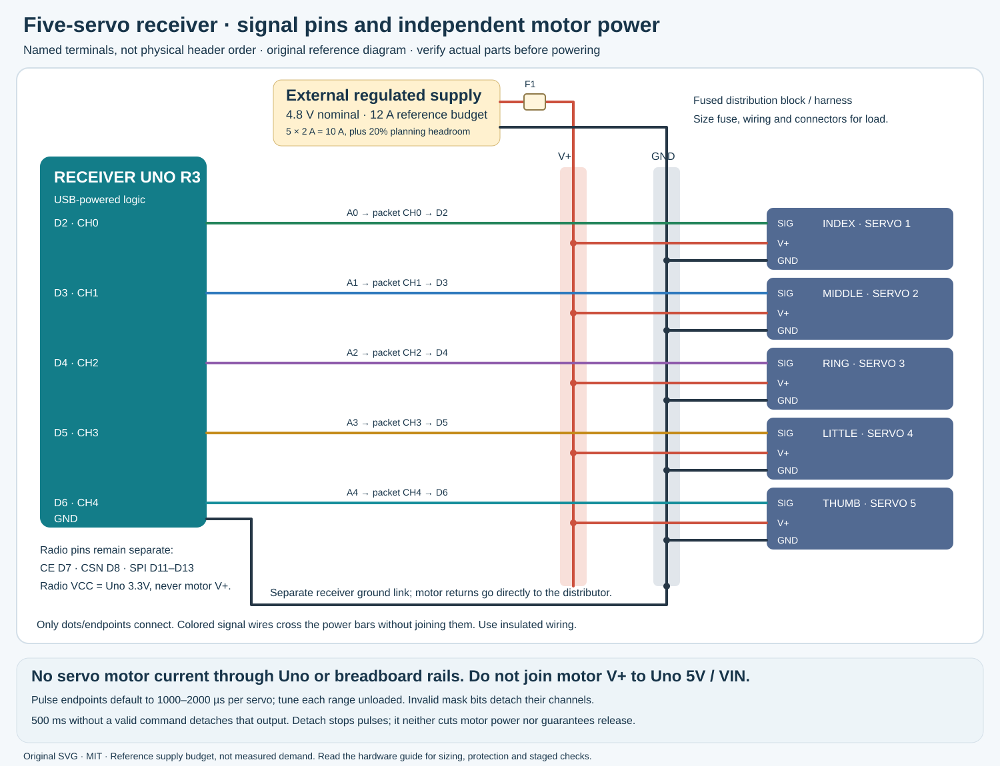

# Reference hardware

For an ordered assembly walkthrough, start with the [glove build guide](../BUILD_GUIDE.md).

## What is known

The original code uses five analog inputs, an RF24 radio with CE=D7/CSN=D8,
and one Servo output on D2. It contains no schematic, part list or photos.
Arduino Uno R3, Spectra Symbol FS-L-0095-103-ST and TowerPro SG90 below are
**reference choices**, not claims about the unidentified original hardware.
No Grove connector, I2C interface or amplified Grove flex module is assumed.

## Bill of materials

Quantities are for the default one-sensor wireless demonstration.

| Qty | Part | Specification / reason |
| --- | --- | --- |
| 2 | Arduino Uno R3 | ATmega328P, 5 V logic, 10-bit ADC, hardware SPI |
| 1 | Resistive flex sensor | Reference Spectra Symbol FS-L-0095-103-ST, 10 kΩ flat ±30% |
| 1 | Fixed resistor | 10 kΩ, 1%, at least 0.125 W, bottom leg of divider |
| 2 | nRF24L01+ module | Standard PCB antenna, no PA/LNA; 250 kbps capable |
| 2 each | Radio bypass capacitors | 100 nF ceramic + 10 µF, ≥6.3 V, at each radio VCC/GND |
| 1 | Positional hobby servo | Reference TowerPro SG90 digital; verify actual unit's supply/travel |
| 1 | Regulated servo supply | 4.8 V, budget 2 A for this reference servo; match actual load |
| 2 | USB cables and power sources | Power the Unos separately; servo current bypasses Uno |
| As needed | Breadboard, short jumpers, strain relief | Mount sensor without bending its terminals |

For the standalone `reader`, omit the second Uno, both radios, servo and servo
supply. For five sensors, add four identical sensor/resistor dividers and set
`kActiveFingers=5`. The receiver supports all five outputs; only valid transmitted channels attach.

For five-finger actuation, also add four servos (five total), a suitably sized
external supply and fused distribution harness/block. The one-servo 2 A supply
row above is for the initial unloaded single-channel reference only; use the
five-servo calculation below for the full setup.

## Circuit and pinout

[Open original SVG circuit](circuit.svg). This is a labeled electrical reference,
not a PCB manufacturing file. Connections are identified by module pin names;
check the orientation of the module in hand rather than assuming a header order.

| Node | Uno pin | Connection | Electrical domain |
| --- | --- | --- | --- |
| Transmitter | 5V | Flex sensor top terminal | 5 V USB-powered Uno rail |
| Transmitter | A0 | Flex bottom terminal + 10 kΩ resistor top | Divider output, 0–5 V |
| Transmitter | GND | 10 kΩ resistor bottom | Local signal ground |
| Transmitter optional | A1–A4 | One additional divider per input | Never enable floating inputs |
| Both nodes | 3.3V | Radio VCC, bypassed locally | Radio supply only; never connect radio VCC to 5 V |
| Both nodes | GND | Radio GND, bypass capacitor negatives | Local common ground |
| Both nodes | D7 | Radio CE | Uno output → radio input |
| Both nodes | D8 | Radio CSN | Uno output → radio input |
| Both nodes | D11 | Radio MOSI | Uno SPI output → radio input |
| Both nodes | D12 | Radio MISO | Radio output → Uno SPI input |
| Both nodes | D13 | Radio SCK | Uno SPI output → radio input |
| Both nodes | — | Radio IRQ | Unconnected; firmware polls |
| Receiver | D2 | Servo 0 / index signal | Channel 0 command pulses |
| Receiver | D3 | Servo 1 / middle signal | Channel 1 command pulses |
| Receiver | D4 | Servo 2 / ring signal | Channel 2 command pulses |
| Receiver | D5 | Servo 3 / little signal | Channel 3 command pulses |
| Receiver | D6 | Servo 4 / thumb signal | Channel 4 command pulses |
| Receiver | GND | Servo GND + external supply negative | Common return, route motor current directly to supply |
| Receiver | — | External supply positive → servo V+ | Regulated 4.8 V; do not join to Uno 5V/VIN |

Power off before wiring. Verify polarity, module labels and supply voltage before
connecting USB. The two wireless nodes do not require a ground wire between
them; each node needs its own local common ground. Avoid routing servo return
current through the radio or breadboard signal-ground wiring.

## Breadboard assembly

[Open the full-size SVG](../images/breadboard-wiring.svg) to zoom into the wires
and hole labels. The top panel is a reproducible **one-sensor reader/transmitter
divider**. The lower panels add the radios and receiver servo. This is an original
reference drawing; no physical breadboard test is claimed.

### Hole-by-hole divider connections

Use a conventional breadboard with separate a–e and f–j strips per numbered row.
Only the a–e side is used. The positions below are examples on the drawing: match
the actual board's markings and verify continuity with power disconnected.

| Part / jumper | First endpoint | Second endpoint | Purpose |
| --- | --- | --- | --- |
| Red supply jumper | Uno 5V | Positive rail, beside row 1 | Supply for the passive divider only |
| Black return jumper | Uno GND | Negative rail, beside row 2 | Common local ground |
| Red row jumper | Positive rail, beside row 5 | a5 | Connect the row-5 strip to 5 V |
| Flex sensor, using flying leads | e5 | e10 | Variable resistance between supply and signal |
| 10 kΩ fixed resistor | c10 | c15 | Bottom leg of the divider; two different strips |
| Green signal jumper | Uno A0 | a10 | Read the row-10 signal junction |
| Black row jumper | a15 | Negative rail, beside row 15 | Return the fixed resistor to ground |

**Why this works:** a10, c10 and e10 share the same metal strip, forming the A0
junction. Row 5 is the sensor's supply, row 10 its output, and row 15 the fixed
resistor's ground return. Do not put both resistor leads into one strip: that
would short the resistor. Holes f10–j10 are separate from a10–e10 across the gap.
The highlighted strips illustrate existing internal connections, not extra wires.

The diagram shows continuous rails only for its illustrated section. Some boards
split rails midway or leave opposite-side rails isolated. Check that the supply
and row jumpers use a continuous section; bridge only confirmed breaks with
same-net jumpers. Do not assume rail color means the board is already powered.
See the breadboard manufacturer's [strip and rail explanation](https://learn.sparkfun.com/tutorials/how-to-use-a-breadboard/).

### Five-sensor breadboard layout

[Open the full-size five-sensor SVG](../images/five-sensor-breadboard.svg).
Use **five passive flex strips and five separate 10 kΩ, 1% fixed resistors** for
the reference parts. This is a new layout, not an overlay on the one-sensor
image. Disconnect all power and remove/reposition the earlier divider jumpers;
for example, the former powered row 5 becomes A0's signal row here.

Feed the positive rail from Uno **5V** beside row 1 and the negative rail from
Uno **GND** beside row 2. For each channel, install all connections in its row:

| Channel / suggested finger | 5 V jumper | Flex sensor leads | Fixed resistor leads | ADC jumper | GND jumper |
| --- | --- | --- | --- | --- | --- |
| 0 / index | + rail → a3 | e3–e5 | c5–c7 | Uno A0 → a5 | a7 → − rail |
| 1 / middle | + rail → a9 | e9–e11 | c11–c13 | Uno A1 → a11 | a13 → − rail |
| 2 / ring | + rail → a15 | e15–e17 | c17–c19 | Uno A2 → a17 | a19 → − rail |
| 3 / little | + rail → a21 | e21–e23 | c23–c25 | Uno A3 → a23 | a25 → − rail |
| 4 / thumb | + rail → a27 | e27–e29 | c29–c31 | Uno A4 → a29 | a31 → − rail |

Each row's a–e strip makes one local connection. Thus a5/c5/e5 are one A0
junction, a11/c11/e11 one A1 junction, and so on. **Do not connect these five
signal junctions together.** Only the supply and ground rails are common.
The unused f–j strips are isolated across the gap; wire passing over them is
insulated and is not plugged into those holes. Dots mark wire endpoints.
The finger assignment is a documented example, not a firmware anatomical model.

Use a board with at least 33 accessible numbered rows as illustrated (a larger
board is fine). Check rail continuity across the whole used section: a rail
break can leave later sensors unpowered. Bridge only matching supply segments
or matching ground segments after verifying continuity. Keep radio VCC on Uno
3.3V separately, and keep servo motor power off these rails.

With power still disconnected, verify that the A0–A4 strips are not directly
shorted to either rail or to each other. After connecting all dividers, enable
five channels and follow the [build/calibration procedure](../BUILD_GUIDE.md#9-expand-to-multiple-fingers).
The software validates each channel's calibration independently; a wiring fault
can still resemble an electrical reading and must be checked physically.

### Add radios by pin name

The lower-left panel applies independently to the transmitter and receiver.
Match the radio's printed **VCC, GND, CE, CSN, MOSI, MISO and SCK** labels to the
Uno pins shown in the panel and the pinout table above. The terminal arrangement
is a named breakout, **not a physical 2×4 pin-order diagram**; header orientation
varies and the original module is unidentified. Use suitable female jumpers or
a labeled breakout. Inserting a bare 2×4 header into ordinary connected five-hole
strips can join pins that must remain separate.

Radio VCC connects directly to **Uno 3.3V**, never to this breadboard's 5 V rail.
C1 is 100 nF ceramic and C2 is 10 µF, both across radio VCC/GND and placed next to
the module with short leads. If C2 is polarized, its positive lead goes to VCC
and its negative lead to GND. Verify its polarity markings rather than relying
on lead length. Leave IRQ disconnected. The electrical limits below still apply.

### Single-channel receiver bench check

The lower-right panel identifies D2, servo signal/V+/GND and the external supply
terminals. Route servo power and return directly to its rated external supply,
with a separate common-ground connection to the receiver. **Do not route servo
motor current through the breadboard or Uno supply rail.** Do not connect the
external supply positive to Uno 5V/VIN. The transmitter and receiver are wireless
nodes and do not need a ground wire between them.

Before powering, check row connections and rail continuity, confirm that 5 V and
GND are not shorted, and verify the actual radio pin labels and capacitor polarity.
Test the single-sensor reader first, then the radios without the servo load,
then an unloaded servo as described in the [build guide](../BUILD_GUIDE.md).

## Five-servo receiver and power

[Open the full-size five-servo wiring SVG](../images/five-servo-receiver.svg).
D2–D6 correspond to channels 0–4, using the suggested index/middle/ring/little/thumb
mapping. These pins avoid the radio's CE=D7, CSN=D8 and SPI D11–D13. The pinned
[Servo AVR implementation](https://github.com/arduino-libraries/Servo/blob/1.3.0/src/avr/Servo.cpp)
supports the five outputs using Timer1; normal `analogWrite` PWM on D9/D10 is
unavailable while the library controls that timer. Servo signal pins do not need
to be hardware PWM pins.

### Supply budget and distribution

For the reference SG90, [TowerPro](https://towerpro.com.tw/product/sg90-7/)
lists 4.8 V operation and gives upper current guidance of 2 A per servo in its
manufacturer response. A **planning calculation** for five is 5 × 2 A = 10 A;
20% additional headroom gives **12 A at regulated 4.8 V nominal**. This is not a
measured five-servo load or a formal universal stall-current rating. Verify the
actual servo specifications, combined startup/stall behavior and supply voltage
under load; resize for your parts and mechanism. Use another voltage only when
the actual servo datasheets permit it.

1. Power the receiver Uno independently by USB as in the existing reference.
2. Run servo-supply positive through appropriately selected protection to a
   power distributor, then a separate positive branch to each servo V+.
3. Return each servo GND directly to the distributor/supply negative, rather
   than daisy-chaining its motor current through the Uno, radio or breadboard.
4. Connect receiver GND to that same negative/common return with its own link.
5. Leave external supply positive isolated from Uno 5V/VIN and radio VCC. The
   radio retains its local Uno 3.3 V supply and bypass capacitors.

Use wiring, terminals and connectors rated for the actual branch and total
currents. Select the main fuse/protection against wire/connector capacity and
startup behavior; the generic F1 symbol is not a prescribed fuse rating. Add
appropriate branch protection for the chosen harness. No fixed wire gauge, fuse
rating or bulk capacitor value can be guaranteed without the actual assembly
and load. Do not use solderless breadboard power strips for motor distribution.

### Pulse calibration and staged verification

`hardware::kServos` in `include/flex/hardware.hpp` holds five `{pin,minUs,maxUs,reversed}`
defaults. A valid saved EEPROM profile overrides the pulse endpoints while pins
remain firmware-owned. Defaults are D2–D6 with 1000–2000 µs endpoints. Use the
[receiver serial calibration guide](../SERVO_CALIBRATION.md) to tune each channel
with `cal`, `set`, optional `invert CH 0|1`, a one-servo `test`, and explicit
`save` without rebuilding. The optional fourth firmware field defaults to false.
In normal direction, commands 10 and 170
map to those endpoints; reversal swaps them for that channel. Command 90 stays
at the integer midpoint. Raw serial pulse tests are not reversed. Endpoints are
clamped and
validated against the library's 544–2400 µs absolute software range, but that
range is not a physical safety rating. Narrow and tune each channel unloaded
before connecting its horn/linkage; recalibrate after changing a mechanism.

All outputs boot detached. A valid frame's mask independently enables each
channel; clear bits detach those outputs on the next synchronization. Invalid
frames do not update command state or freshness. An enabled channel detaches
when its last valid command is at least 500 ms old; valid data can reattach it.
Servo pulse targets are set before enabling output, including recovery. Detach
stops pulses; it does not remove power or guarantee that a servo releases torque.

Start with one unloaded D2 servo and the single-sensor transmitter default. For
all five, first validate the five-sensor reader, set `kActiveFingers=5`, flash the
transmitter, then connect and calibrate one unloaded servo at a time. Check the
mapping, endpoint travel and current draw. Finally verify simultaneous movement,
partial invalidity, full calibration, transmitter power loss and recovery while
watching supply stability. These are required bench checks, not tests already
performed by this repository's software CI.

## Electrical rationale and constraints

The [Spectra Symbol stock sensor datasheet](https://cdn.sparkfun.com/datasheets/Sensors/ForceFlex/FLEX%20SENSOR%20DATA%20SHEET%202014.pdf)
identifies a 10 kΩ nominal flat sensor (7–13 kΩ) whose resistance rises when bent.
It is a passive resistance, not a digital sensor. This reference divider is:
`5V → flex → A0 → 10kΩ → GND`. With the default Uno ADC reference at its supply,
`ADC ≈ 1023 × 10000 / (Rflex + 10000)`. At nominal flat resistance it reads about
512, and at 20 kΩ about 341. These are calculations, not measured results.
At any positive flex resistance, the divider's Thevenin resistance is below
10 kΩ. This matches the [ATmega328P ADC source-impedance guidance](https://ww1.microchip.com/downloads/aemDocuments/documents/MCU08/ProductDocuments/DataSheets/ATmega48A-PA-88A-PA-168A-PA-328-P-DS-DS40002061B.pdf).
Firmware also discards the first conversion after selecting each channel.
Use a buffer if adapting a substantially higher-impedance circuit. A 2.2-inch
sensor can have a different nominal resistance: check its own datasheet and
reselect the fixed resistor rather than assuming all flex sensors are 10 kΩ.

The [Uno R3 pinout and manual](https://docs.arduino.cc/hardware/uno-rev3/)
identify the analog and SPI pins. The Uno 3.3 V output is rated at 50 mA;
this reference uses one standard non-amplified radio per Uno. PA/LNA modules
require a separately sized supply and are outside this BOM.

The [Nordic nRF24L01+ product specification v1.0](https://docs.nordicsemi.com/r/bundle/pdf_ps_nrf24l01p/)
rates VDD at 1.9–3.6 V and describes 5 V tolerant digital inputs, not a 5 V
supply. When input signals exceed 3.6 V, its specified VDD condition is
2.7–3.3 V. Direct Uno signals in this reference therefore require that the radio
supply stays within that condition. Verify the rail; use appropriate level
translation if it does not, or if the actual module/clone has different limits.
The 3.3 V MISO signal is sufficient for the Uno's normal digital input high
threshold at a 5 V supply. Place both bypass capacitors next to each radio and
keep SPI leads short. Check module-specific documentation before substituting
unidentified clones or regulated adapter boards.

[TowerPro's SG90 digital page](https://towerpro.com.tw/product/sg90-7/)
specifies 4.8 V operation and an external adapter; its manufacturer response
indicates current can reach 2 A. The supply budget above follows that reference,
but actual stall current and travel need validation on the actual servo.
The receiver now narrows command pulses to per-servo 1000–2000 µs endpoints by
default. Even these endpoints can exceed a particular unit's mechanical travel;
adjust and save the corresponding channel through receiver serial calibration
before coupling a mechanism. Changing `kServos` defaults does not override a
valid saved EEPROM profile.
The single-channel supply budget does not apply to five servos; use the full
supply/distribution section above.

## Bench validation still required

The firmware was compiled and its pure core tested on a host. No assembled
hardware was available. Before using the wireless demonstration:

1. Run the serial-only reader; verify rest/bent ADC values and recalibration.
2. Confirm radio VCC and signal levels under load; check for brownouts.
3. Establish ACKs with the servo supply disconnected, then power the unloaded servo.
4. Verify travel and polarity; confirm pulses stop when the transmitter is removed
   or a calibration packet is invalid. Detach does not guarantee removal of torque.
5. Evaluate RF reliability, latency, power supply behavior and mechanical safety
   for the intended setup. This is a hobby reference, not a validated control system.
